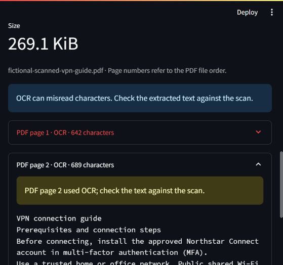
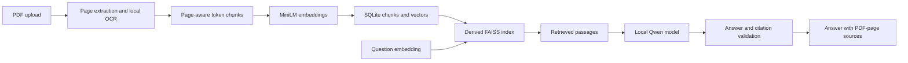

# DocuAssist

A working local Retrieval-Augmented Generation (RAG) document assistant. Upload text or scanned PDFs, search their contents, ask independent questions, and inspect the passages and PDF pages supporting each answer. Embeddings and generation run locally; no API key is required.

Built with Python, FastAPI, Streamlit, SQLite, RapidOCR/ONNX Runtime, all-MiniLM-L6-v2, FAISS, and Qwen2.5-1.5B-Instruct served by llama.cpp on CPU.



**Run locally on Windows**

Use Python 3.11 or 3.12. Python 3.12 and a 16 GB RAM laptop were verified. Install dependencies in an isolated environment:

```powershell
python -m venv .venv
.\.venv\Scripts\python.exe -m pip install -r requirements-dev.txt
.\.venv\Scripts\python.exe scripts/setup_models.py
```

The one-time setup downloads approximately 1.2 GB of public model/runtime files. Model revisions and the CPU runtime build are pinned; model LFS and runtime checksums are verified. Models live in ignored data/models, and the runtime in ignored .cache/llamacpp. After setup, the default answering workflow needs no internet connection.

Start three separate terminals:

```powershell
.\scripts\run-model.ps1
```

```powershell
.\scripts\run-backend.ps1
```

```powershell
.\scripts\run-frontend.ps1
```

Open the [interface](http://127.0.0.1:8511) and [API documentation](http://127.0.0.1:8011/docs). The model listens on localhost:8012. Use one backend worker and one model slot. Changing model context size requires restarting both the model and backend.

For Linux/macOS, install a compatible llama-server, set LLAMACPP_SERVER to its path, run setup_models.py, then launch scripts/run_model.py and the usual Uvicorn/Streamlit commands. The portable runtime was verified on Windows; other platforms were not tested.

**Try the full workflow**

1. Upload sample_docs/fictional-vpn-guide.pdf or its image-only fictional-scanned-vpn-guide.pdf counterpart.
2. In Ask your documents, select that manual or All documents.
3. Ask: "What must I do before connecting to the VPN?" Inspect the supporting passage on PDF page 2.
4. Ask a question absent from the manual, such as "What is my salary payment date?"
5. Switch to Find passages to inspect retrieval independently of generation.
6. Delete the uploaded manual and repeat the search. Removed passages stay absent after restart.

These manuals are fictional demonstration data, not employer policies. Check generated answers against their sources.

**Architecture**



Chunks use the real model tokenizer: 200 content tokens, 30-token overlap, no cross-page chunks, and explicit checks against MiniLM's 256-token limit. Mean-pooled 384-dimensional float32 vectors are normalized and stored with stable source IDs and a model/chunking fingerprint. Long questions are rejected instead of silently truncated.

FAISS IndexFlatIP ranks normalized vectors by cosine similarity. Up to five passages are retrieved. A 0.20 similarity gate was tuned on development questions; it is not an answer-correctness probability. The generator must still judge whether requested information is present. Document filters apply before ranking.

llama.cpp applies the actual model chat template and tokenizer to budget the prompt. The model returns structured status, answer, and citation IDs. Unknown IDs are rejected; filenames, PDF pages, and passages come from stored records. Missing inline markers are rendered from validated structured IDs. Explicit refusals are normalized to insufficient_evidence, with no supporting-answer citations. Invalid output gets one bounded retry. Provider failures remain errors, rather than being described as missing evidence. Short vague failure reports ask which service/device is affected.

**Persistence and changes**

SQLite is canonical. FAISS and its matching source map rebuild from stored vectors on startup. Existing extracted documents are indexed automatically when embeddings are ready. Changed model/chunk settings trigger re-indexing. Schema version 3 preserves existing document IDs, text, warnings, and original PDFs.

Uploads/re-extraction prepare vectors and a replacement index before committing document/page/vector records together. Failures preserve previous records and search state. Exact duplicates reuse vectors. Deletion cascades through pages/chunks and swaps the corresponding index snapshot. Original-file cleanup and crash recovery remain supported.

One shared lock serializes collection changes, retrieval, and generation, keeping citations consistent. Long answers temporarily delay upload/deletion. The interface clears old answers whenever the collection version changes.

**API**

| Method | Endpoint | Behavior |
|---|---|---|
| GET | /health | OCR, retrieval and generator readiness; collection counts/limits |
| POST | /documents | Extract and index a PDF; 201 new, 200 duplicate |
| GET | /documents | Persistent document list |
| GET | /documents/{id}/pages | Page text, extraction method and warnings |
| POST | /documents/{id}/reextract | Atomically refresh extraction and searchable content |
| DELETE | /documents/{id} | Remove original and searchable records |
| POST | /search | Ranked passages with trusted source metadata |
| POST | /ask | Answer/status, sources, model, request ID and timings |

Search/ask payload:

```json
{"question":"What must I do before connecting to the VPN?","document_ids":null,"k":5}
```

document_ids=null searches the collection; a non-empty list restricts it to existing IDs. Answer statuses are answered, insufficient_evidence, clarification, or ambiguous. Document status describes extraction; upload indexed and health indexed_document_count describe search readiness separately.

**Configuration and troubleshooting**

Copy .env.example to an ignored .env to change data paths, OCR, chunking, retrieval, or model settings. Credentials, uploads, vectors, models, and local logs remain ignored. User filenames are display labels; generated IDs determine storage paths. Full questions and document passages are not logged by default.

If embeddings are missing, run setup_models.py and restart the backend. PDF extraction remains available, with an indexing warning. If generation is offline, start run-model.ps1; passage search still works. Check /health and ignored .cache logs.

An optional Ollama adapter is implemented: set DOCUASSIST_LLM_PROVIDER=ollama, DOCUASSIST_LLM_URL=http://127.0.0.1:11434, and DOCUASSIST_LLM_MODEL to an installed tag, then start Ollama separately. It uses a conservative UTF-8 byte-based prompt budget. The verified real-model path is llama.cpp/Qwen.

**Tests and evaluation**

```powershell
.\scripts\run-tests.ps1
.\.venv\Scripts\python.exe evaluation/check_dataset.py
.\.venv\Scripts\python.exe evaluation/run_evaluation.py --split dev
.\.venv\Scripts\python.exe evaluation/run_evaluation.py --split holdout_v2
```

Checks cover ingestion/OCR, token limits, normalized real embeddings, source provenance, duplicate reuse, filtering, restart/deletion, configuration re-indexing, atomic vector rollback, re-extraction, concurrent answering/deletion, provider errors and citations. Controlled generators/vectors test plumbing and do not establish answer quality. The real MiniLM check runs when setup models exist.

Evaluation uses isolated collections containing only the five fictional manuals. It compares vector retrieval with a TF-IDF baseline over the same chunks and records real answers, statuses, source coverage, latency and the prompt fingerprint. Current reports are evaluation/results/dev.json and evaluation/results/holdout_v2.json. The original final.json report used a retired prompt and remains historical. Status agreement and retrieval hit rate are not factual accuracy; review the answers and source support. See [build progress](docs/progress.md) for verified results and known errors.

**Limits**

This is a small local single-owner project with independent questions, no chat memory, authentication, production hosting, or multi-user collection isolation. The small CPU model can be verbose, refuse answerable questions, or make unsupported claims despite valid IDs. Citation validation does not prove factual support or reliably resolve conflicting documents. Synthetic evaluation does not establish enterprise-document performance.

OCR is verified on clean, upright printed English scans. It can misread or omit text. Rotate sideways scans first; handwriting, complex layouts, and table structure are not validated. Existing embedded text takes precedence. Defaults are 180 DPI, four million rendered pixels per page, and ten OCR candidate pages per PDF.

See the [architecture plan](docs/architecture-plan.md) and [requirements](docs/requirements.md). Official references: [MiniLM](https://huggingface.co/sentence-transformers/all-MiniLM-L6-v2), [FAISS metrics](https://github.com/facebookresearch/faiss/wiki/MetricType-and-distances), [llama.cpp server](https://github.com/ggml-org/llama.cpp/blob/master/tools/server/README.md), and [Qwen model](https://huggingface.co/Qwen/Qwen2.5-1.5B-Instruct-GGUF).
