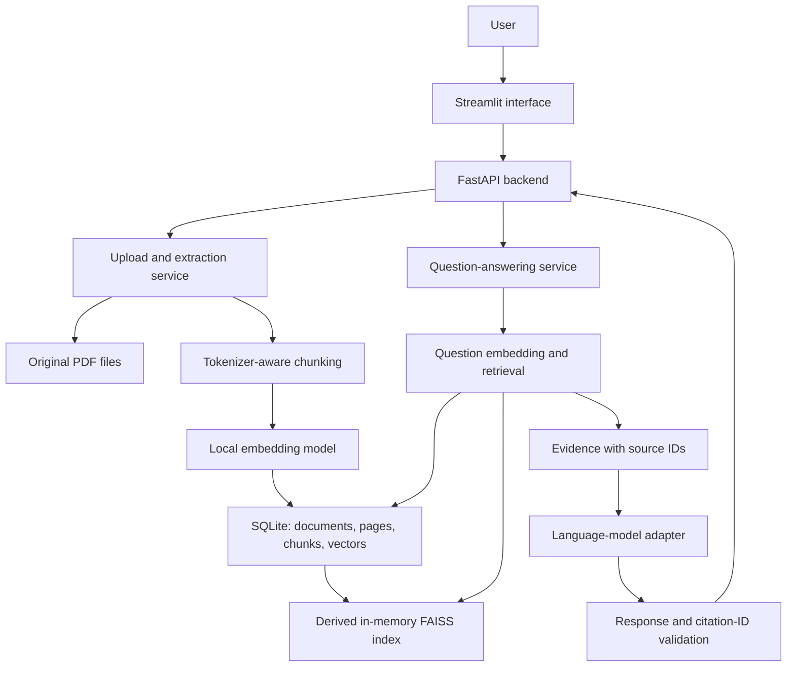

**DocuAssist: full architecture and build checklist**

Build a local document question-answering assistant for an AI/ML portfolio. A user uploads IT support PDFs, asks a question, and receives an answer supported by document passages and PDF page citations. The local RAG workflow is now implemented: ingestion/OCR, token chunking, persistent embeddings, FAISS retrieval, real local-model generation, API, source inspection, and evaluation. This document retains the original build checklist as design guidance; progress.md records verified behavior and remaining work.

The first release has one owner and one shared local document collection. It supports English text/scanned PDFs and independent questions. MiniLM embeddings run with ONNX Runtime. After checking the laptop's 16 GB RAM and integrated graphics, the verified generator uses Qwen2.5-1.5B-Instruct Q4_K_M with the portable llama.cpp CPU server. An optional Ollama adapter shares the generator interface. Model revisions, chunk parameters, actual generator, and timings are recorded during evaluation.

**Target architecture**



There are two workflows. Uploading produces searchable evidence: PDF -> pages -> chunks -> embeddings -> searchable index. Asking produces a grounded response: question -> embedding -> retrieved evidence -> language model -> validated response with sources. The frontend calls the backend and never creates its own index or accesses SQLite directly.

| Component | Choice | Responsibility |
|---|---|---|
| Development runtime | Python 3.12 | Verified; dependency files support 3.11/3.12 |
| Interface | Streamlit | Upload, document list, question input, answers, source passages |
| Backend | FastAPI, Uvicorn | HTTP endpoints, validation, orchestration |
| PDF parser | pypdf | Extract text page by page |
| Embedding model | sentence-transformers/all-MiniLM-L6-v2 via ONNX Runtime | Convert passages and questions to normalized 384-dimensional vectors |
| Vector search | FAISS IndexFlatIP | Exact nearest-neighbor search for the small collection |
| Canonical storage | SQLite | Persist document records, page text, chunks, vectors |
| Original files | Local data directory | Store PDFs under generated document IDs |
| Generator | Local llama.cpp/Qwen; optional Ollama adapter | Produce structured answers from retrieved evidence |
| Packaging | Local launch/setup scripts; Docker Compose remains an extension | Run with persistent backend data |
| Verification | pytest and a fixed evaluation dataset | Check behavior and measure retrieval/answer quality |

Use the project Git repository. All proposed paths in the tree below are relative to its root:

```text
docuassist/
  backend/
    __init__.py
    main.py                 # FastAPI application and startup
    config.py               # Settings and paths
    schemas.py              # Request/response and internal record models
    storage.py              # SQLite operations
    ingestion.py            # Upload validation and PDF extraction
    chunking.py             # Tokenizer-aware splitting
    embeddings.py           # Embedding model loading and encoding
    search.py               # Index construction, ID mapping, retrieval
    llm.py                  # Generator interface and provider adapter
    answering.py            # Evidence preparation and answer validation
    routers/
      __init__.py
      documents.py
      questions.py
  frontend/
    app.py
  scripts/
    ingest_sample.py
    inspect_chunks.py
    preview_search.py
  sample_docs/               # Fictional/public demonstration PDFs
  data/                     # Ignored runtime PDFs and SQLite database
  evaluation/
    dev.jsonl
    final.jsonl
    run_evaluation.py
    results/                # Measured output, with model/configuration details
  tests/
    fixtures/
    test_ingestion.py
    test_chunking.py
    test_search_lifecycle.py
    test_answering.py
    test_api.py
  docs/
    architecture-plan.md
    requirements.md
    demo-script.md
  requirements.txt
  .env.example
  .gitignore
  Dockerfile.backend
  Dockerfile.frontend
  compose.yaml
  README.md
```

Create modules when their implementation step is reached, rather than filling the repository with empty files immediately.

1. **Define the problem and first-release boundaries.**

   Tasks:
   - [ ] Write a short requirements document: an employee wants answers from uploaded IT support manuals without searching every PDF manually.
   - [ ] Define the supported functions: upload text or scanned PDFs, list documents, search passages, ask a question, display supporting passages, delete a document, and recover the collection after restart.
   - [ ] Set initial limits: 10 PDFs per collection, 10 MiB per file, 50 PDF pages per document, at most 10 pages needing OCR, English printed documents, and independent questions. These are project settings, not library limits.
   - [ ] Define answer behavior: supported answer, insufficient evidence, ambiguous/conflicting evidence, or a useful processing/provider error.
   - [ ] Describe the demonstration: upload a fictional VPN guide, ask about setup, inspect its supporting page, ask an absent-answer question, delete the guide, and repeat the question.

   Deliverable: requirements and acceptance scenarios. Completion check: every required behavior has an example that can later be verified. Basic OCR for upright printed scans is included. Handwriting/layout-aware OCR, conversational follow-ups, user accounts, and multi-user collection isolation are later extensions.

2. **Prepare the environment and repository.**

   Tasks:
   - [ ] Check the installed Python version and available RAM/disk. Choose a compatible interpreter before installing dependencies.
   - [ ] Create a virtual environment at the project root. Use its Python directly so PowerShell activation-policy changes are unnecessary.
   - [ ] Install the starting packages, verify imports, and record working versions in the dependency file. Check FAISS installation early; if the Windows environment cannot install a compatible distribution, use the Linux Docker environment for the backend.
   - [ ] Add ignored paths for the virtual environment, runtime data, local environment files, caches, and test artifacts. Keep sample demonstration documents separate from runtime uploads.
   - [ ] Add configuration for data paths, upload limits, embedding model/revision, chunk size, overlap, retrieval count, LLM provider/model, and timeouts. Keep credentials outside source code.

   Example PowerShell setup, run from the project root after choosing Python 3.11:

   ```powershell
   py -3.11 -m venv .venv
   .\.venv\Scripts\python.exe -m pip install --upgrade pip
   .\.venv\Scripts\python.exe -m pip install fastapi uvicorn python-multipart pydantic-settings pypdf sentence-transformers faiss-cpu numpy streamlit httpx scikit-learn pytest
   .\.venv\Scripts\python.exe -c "import fastapi, pypdf, sentence_transformers, faiss, streamlit; print('Imports OK')"
   .\.venv\Scripts\python.exe -m pip freeze > requirements.txt
   ```

   Deliverable: a working development environment and reproducible dependency list. Completion check: imports work and a minimal backend/frontend can be launched. Installing packages downloads dependencies; these commands are instructions, not commands already executed.

3. **Create demonstration documents and evaluation questions.**

   Tasks:
   - [ ] Prepare 5–10 fictional IT PDFs: VPN setup, password resets, software installation, device troubleshooting, and support escalation. Keep their procedures internally consistent.
   - [ ] Include an empty/scanned fixture and a malformed fixture for error behavior; keep them outside the normal knowledge collection.
   - [ ] Write 30 question records: 12 direct questions, 6 paraphrased questions, 6 absent-answer questions, 3 ambiguous/conflicting cases, and 3 document-instruction cases.
   - [ ] For each answerable question, record the expected answer and supporting document/page references. For absent-answer questions, set answerable=false.
   - [ ] Assign approximately 20 records to development and 10 to final evaluation. Keep paraphrases of the same underlying question in the same split and ensure both splits have answerable and absent-answer cases.

   Example record:

   ```json
   {
     "id": "vpn-setup-01",
     "question": "What must I do before connecting to the VPN?",
     "answerable": true,
     "expected_answer": "Install the approved client and enroll in MFA.",
     "support": [{"document": "fictional-vpn-guide.pdf", "pdf_page": 2}],
     "category": "direct",
     "group_id": "vpn-prerequisites"
   }
   ```

   Deliverable: a known document collection and fixed evaluation records. Completion check: supporting pages have been checked by reading the PDFs. Synthetic documents make the workflow reproducible but limit claims about performance on real enterprise documents.

4. **Define storage and API contracts.**

   Tasks:
   - [ ] Implement SQLite initialization and enable foreign-key enforcement on every connection.
   - [ ] Store documents with ID, original display name, SHA-256 hash, controlled storage path, status, timestamp, and extraction warnings/errors.
   - [ ] Store pages with document ID, one-based PDF page number, extracted text, extraction method (text/ocr/none), and warnings.
   - [ ] Store chunks with stable ID, document ID, PDF page number, ordinal, text, token count, normalized float32 embedding, dimension, and embedding/chunking configuration fingerprint.
   - [ ] Define Pydantic request/response models before wiring HTTP routes. Define states such as processing, ready, ready_with_warnings, and failed. Queries only use ready content.
   - [ ] Use SQLite as the canonical source of truth. FAISS is derived search state that can be rebuilt.

   | Entity | Important relationship |
   |---|---|
   | documents | One record per accepted document; exact active duplicates share a record |
   | pages | Many pages belong to one document |
   | chunks | Many chunks belong to one page/document; vectors use the same stable chunk IDs |
   | configuration | Current model/revision and chunking fingerprint must match searchable vectors |

   Deliverable: storage functions and data contracts. Completion check: insert/read a document and confirm foreign keys and cascading removal behave correctly.

5. **Implement upload validation and page-by-page extraction.**

   Tasks:
   - [ ] Validate file size, PDF signature, successful parsing, and page-count limits; filename extensions alone are insufficient.
   - [ ] Handle malformed and password-protected PDFs with clear errors. Store uploads using generated IDs, preserving original names only for display.
   - [ ] Compute the file hash and reuse the existing ready document for an exact duplicate. Allow a failed upload to be retried.
   - [ ] Extract each page separately and store its one-based PDF page number. Normalize whitespace conservatively while keeping paragraph breaks.
   - [x] Add local OCR fallback for pages with no embedded text. Render with PDFium at 180 DPI within a 4 million pixel budget, then recognize with packaged RapidOCR models on CPU. Reject more than 10 OCR candidate pages before recognition.
   - [x] Preserve PDF page numbers and label OCR provenance. Warn that OCR text needs review. Retain readable pages when an individual page fails; reject wholly unreadable PDFs with useful errors and no stored records.
   - [x] Migrate version 1 SQLite pages without losing existing text, warnings, document IDs, or originals. Reuse stored extraction results on exact duplicate uploads.
   - [x] Support explicit re-extraction of stored PDFs with OCR. Preserve document identity/original files, atomically replace extraction results, and retain old results after fatal failures or loss of a previously readable page.
   - [ ] Keep failed ingestion out of retrieval and clean up incomplete temporary files.

   Deliverable: ingestion service and sample ingestion script. Completion check: text and PDF page numbers match the original; duplicates do not double the searchable content. Citations explicitly say PDF page, because printed page labels may differ. pypdf cannot extract text from images without an OCR stage. [pypdf documentation](https://pypdf.readthedocs.io/en/stable/user/extract-text.html).

6. **Implement tokenizer-aware chunking.**

   Tasks:
   - [ ] Load the embedding model's tokenizer and split page text at sentence/paragraph boundaries where possible.
   - [ ] Start at approximately 200 content tokens per chunk and 30 tokens of overlap. Count the model's tokens, not words or characters.
   - [ ] Keep each chunk within one PDF page for straightforward provenance. Store stable IDs and the source page with each chunk.
   - [ ] Assert that every encoded chunk, including special tokens, fits the loaded model's sequence limit. Prevent silent truncation.
   - [ ] Inspect samples for missing text, empty passages, repeated headers, and broken context.

   Deliverable: chunking module and inspection script. Completion check: token-bound checks pass and every passage maps to its original page. all-MiniLM-L6-v2 produces 384-dimensional vectors and defaults to truncating text beyond 256 wordpieces. [Official model card](https://huggingface.co/sentence-transformers/all-MiniLM-L6-v2).

7. **Create and persist embeddings.**

   Tasks:
   - [ ] Load the embedding model once at backend startup, rather than for each request.
   - [ ] Encode chunks in batches and normalize vectors. Persist float32 vectors alongside their stable chunk IDs.
   - [ ] Encode questions using the same model/revision and normalization settings. Handle questions exceeding its input limit explicitly rather than silently truncating.
   - [ ] Record the model revision, dimension, and chunk configuration. Changing these requires re-chunking/re-embedding as appropriate.
   - [ ] Verify vector shape, finiteness, and mapping counts. Reuse stored embeddings when rebuilding an unchanged collection.

   Deliverable: embedding service and persisted vectors. Completion check: passage and question vectors have compatible dimensions and survive a backend restart through SQLite storage.

8. **Build a consistent FAISS index.**

   Tasks:
   - [ ] Build IndexFlatIP from normalized active vectors. Preserve an immutable row-position-to-chunk-ID mapping alongside each index object.
   - [ ] Keep the index in memory for version one. Reconstruct it from SQLite on startup and after successful uploads/deletions.
   - [ ] Run one backend worker. Use one lock to serialize collection mutations and queries so readers see a consistent index/mapping pair.
   - [ ] Build the replacement index first, commit the corresponding database change, and swap the completed index plus mapping under the lock. On failure, preserve the previous ready collection. Rebuild from committed SQLite state after a process crash.
   - [ ] Handle an empty collection and a model/configuration mismatch explicitly.

   Deliverable: index builder and collection lifecycle. Completion check: index vector count, mapping count, and active chunk count agree. Normalized vectors with inner-product search yield cosine similarity; similarity scores are not probabilities of answer correctness. [FAISS metric documentation](https://github.com/facebookresearch/faiss/wiki/MetricType-and-distances).

9. **Implement retrieval and a keyword baseline.**

   Tasks:
   - [ ] Create a search function that returns up to five chunk records with text, document ID/name, PDF page, and similarity score.
   - [ ] Ignore invalid search positions and resolve vector positions through the index's matching ID map. Deduplicate identical evidence without losing provenance.
   - [ ] Print search previews for development questions. Diagnose missing evidence in this order: extraction, chunk boundaries, embeddings, then retrieval settings.
   - [ ] Implement a simple TF-IDF keyword baseline using the same chunks and question split for comparison.
   - [ ] Tune any relevance rejection threshold on development examples. Combine retrieval checks with evidence sufficiency during generation; the nearest passage can still be irrelevant.

   Deliverable: search preview script and baseline. Completion check: known supporting passages appear for the development questions, and absent-answer cases are inspected. Save measured results rather than assuming vector retrieval is always better.

10. **Implement deletion and restart recovery.**

   Tasks:
   - [ ] Remove the document's pages, chunks, and vectors using a database transaction, update search state under the same collection lock, and remove the original PDF.
   - [ ] Make deletion's reported status reflect cleanup failures; retry or record file cleanup rather than silently claiming completion.
   - [ ] Avoid answer caching initially. If it is added later, invalidate entries using the collection generation/version.
   - [ ] Clear displayed answers in the frontend after collection changes so old citations are not shown as current evidence.
   - [ ] Restart the backend and rebuild search from active SQLite records. Verify deleted content stays absent.

   Deliverable: deletion/recovery behavior. Completion check: adding, deleting, restarting, and searching never returns deleted passages or mismatched source IDs.

11. **Implement the language-model adapter.**

   Tasks:
   - [ ] Define one generator interface that accepts system instructions, a question, labelled evidence, a timeout, and an output budget.
   - [ ] Use a stub only for automated plumbing checks. Clearly label it and exclude it from answer-quality evaluation.
   - [ ] Check whether a small local instruction model runs acceptably on the laptop. If so, implement an Ollama chat adapter and record the selected model. Otherwise implement one hosted provider behind the same interface with external credentials and an explicit cost budget.
   - [ ] Bound timeout, retries, and output size. Return an explicit provider error when generation fails; do not reinterpret a timeout as absent document evidence.
   - [ ] Keep model/provider configuration in settings so storage and search do not depend on one generator vendor.

   Implemented: a real local llama.cpp generator with native JSON-schema-constrained completion, chat-template/tokenizer budgeting, bounded output and timeouts, and model readiness. Optional Ollama support uses its structured chat API and a conservative byte budget. [llama.cpp server](https://github.com/ggml-org/llama.cpp/blob/master/tools/server/README.md), [Ollama documentation](https://docs.ollama.com/api/chat).

12. **Connect retrieval to grounded answering.**

   Tasks:
   - [ ] Retrieve candidate passages, deduplicate them, and fit evidence into the chosen generator's context window while reserving space for instructions, the question, and output. Use the generator's token rules rather than the embedding tokenizer for this budget.
   - [ ] Assign request-local evidence IDs such as S1 and S2. Supply instructions that the evidence is untrusted document content and answers must be supported by it.
   - [ ] Request a structured answer status, answer text, and citation IDs. Ask for insufficient evidence when the answer is absent, and for clarification or a qualified explanation when evidence is ambiguous/conflicting.
   - [ ] Validate the response schema and reject unknown source IDs. Map known source IDs to trusted stored filenames, pages, and passages; do not accept page numbers invented by the generator.
   - [ ] Retry malformed output at most once, then return a useful generation error. A valid citation ID is only a structural check; evaluate factual support separately.
   - [ ] Record stage timings, model ID, request ID, and status without logging complete uploaded text by default.

   Example response contract:

   ```json
   {
     "status": "answered",
     "answer": "Install the approved client and enroll in MFA before connecting. [S1]",
     "sources": [
       {
         "source_id": "S1",
         "chunk_id": "stable-chunk-id",
         "document_id": "stable-document-id",
         "filename": "fictional-vpn-guide.pdf",
         "pdf_page": 2,
         "passage": "Before connecting, install the approved client and enroll in MFA."
       }
     ],
     "request_id": "request-id",
     "latency_ms": 0
   }
   ```

   The response is illustrative, not a measured result. Completion check: supported, absent-answer, ambiguous, and document-instruction examples receive the intended behavior.

13. **Expose FastAPI endpoints.**

   Tasks:
   - [ ] Wire tested services to routes and load storage/models/index at startup.
   - [ ] Use bounded synchronous upload processing for the small local collection. The upload request returns the completed document status; background job queues are a later scaling extension.
   - [ ] Return consistent validation, empty-collection, processing, missing-document, and provider-error responses. Include extraction warnings in document responses.
   - [ ] Bind the development backend to localhost and run one worker to match the in-memory index design.
   - [ ] Verify each route through the generated interactive API documentation before building the UI.

   | Method | Route | Contract |
   |---|---|---|
   | GET | /health | Backend readiness and loaded model/index state |
   | POST | /documents | Multipart PDF upload; completed document ID/status or useful error |
   | GET | /documents | Active documents and extraction warnings |
   | DELETE | /documents/{document_id} | Remove document and its searchable content |
   | POST | /search | Question -> passages and retrieval scores, for debugging |
   | POST | /ask | Question -> status, answer, sources, timing/request ID |

   Deliverable: backend API. Completion check: upload -> search -> ask -> delete works through HTTP. FastAPI supports separating routers into modules. [FastAPI documentation](https://fastapi.tiangolo.com/tutorial/bigger-applications/).

14. **Build the Streamlit interface.**

   Tasks:
   - [ ] Implement upload controls, document list, extraction warnings, and deletion controls.
   - [ ] Add a question input, processing indicator, answer area, and expandable source passages labelled with PDF page numbers.
   - [ ] Add an optional retrieval-preview panel for demonstration and debugging. Label similarity as a retrieval score.
   - [ ] Send HTTP calls to FastAPI. Keep credentials, model loading, database access, and vector indexing in the backend.
   - [ ] Handle empty collections, invalid PDFs, and provider errors using plain messages. Clear stale answers after upload/deletion.

   Deliverable: usable interface. Completion check: a new user can complete the demonstration without editing code. Streamlit has upload and chat components suitable for this UI. [Upload documentation](https://docs.streamlit.io/develop/api-reference/widgets/st.file_uploader), [chat tutorial](https://docs.streamlit.io/develop/tutorials/chat-and-llm-apps/build-conversational-apps).

15. **Evaluate, fix failures, and add meaningful checks.**

   Tasks:
   - [ ] Evaluate the keyword baseline and vector search on development questions. Tune chunk size, overlap, k, and rejection behavior using that split.
   - [ ] Calculate retrieval hit@5 for answerable questions: fraction with at least one known supporting page among the five retrieved passages. Also inspect whether all evidence is present for questions needing multiple passages.
   - [ ] Review answers manually against expected answers and cited evidence. Record answer correctness, claim support, citation support, false answers on absent-answer questions, and ambiguous/conflicting-case behavior.
   - [ ] Measure response latency by stage using the actual model/hardware; report median and p95 with question counts. Record costs only when a hosted generator is used.
   - [ ] Add focused checks for tokenizer bounds, page provenance, duplicate upload, malformed/scanned PDFs, add/delete/restart consistency, no evidence, and unknown citation IDs.
   - [ ] Use controlled generator responses for deterministic structural checks and separate real-model evaluation for answer quality.
   - [ ] Freeze configuration and run the held-out final split. Report failures honestly. If final questions guide further changes, treat them as development data and prepare a fresh held-out set.

   Deliverable: evaluation script, measured results, and relevant checks. Completion check: results identify the actual model/configuration, distinguish retrieval from generation failures, and contain no invented accuracy claims.

16. **Package, document, and prepare the interview demo.**

   Tasks:
   - [ ] Add backend and frontend Dockerfiles and Compose services. Run one backend process, mount persistent backend data, and configure the frontend's backend URL.
   - [ ] Keep credentials outside images. Configure access to a local generator explicitly; localhost inside a container refers to that container, not the host laptop.
   - [ ] Verify that restart preserves uploaded documents and reconstructs search correctly.
   - [ ] Write README setup instructions, architecture, configuration, API examples, actual evaluation results, limitations, and troubleshooting.
   - [ ] Record a 2–3 minute demo: upload -> supported question -> inspect sources -> absent-answer question -> delete -> repeat search.
   - [ ] Prepare interview explanations: why RAG, why overlapping chunks, embedding versus generation roles, why SQLite plus FAISS, how citations work, how absent evidence is handled, and what would change at larger scale.

   Deliverable: reproducible local portfolio project. Completion check: a clean environment can run the documented demo. Follow FastAPI's container deployment guidance for the backend. [FastAPI Docker documentation](https://fastapi.tiangolo.com/deployment/docker/).

   A later public multi-user release needs authenticated owners, collection isolation enforced before retrieval, rate limits, persistent hosting, resource bounds, and a different concurrency/index deployment design. Those are separate extension tasks rather than requirements for the first local demonstration.

**Milestones and suggested order**

| Milestone | Steps | Observable result |
|---|---|---|
| Documents become structured data | 1–5 | Correct extracted pages and reliable upload behavior |
| Documents become searchable | 6–10 | Search returns evidence; deletion/restart stay consistent |
| Questions receive supported answers | 11–13 | Real-model answers and sources work through the API |
| Portfolio is usable and reviewable | 14–16 | UI, measured evaluation, packaging, and interview demo |

The local document-to-answer workflow is implemented. Refer to progress.md and the measured evaluation reports rather than treating unchecked items in this original design checklist as current feature status. Container packaging, production authentication, multi-user collection isolation, stronger model evaluation, and richer document/layout handling remain extensions.
